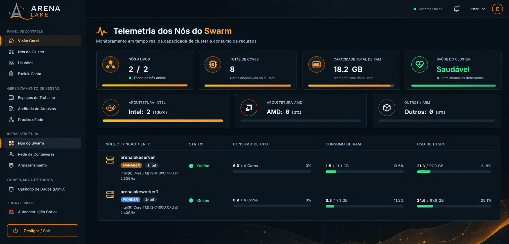
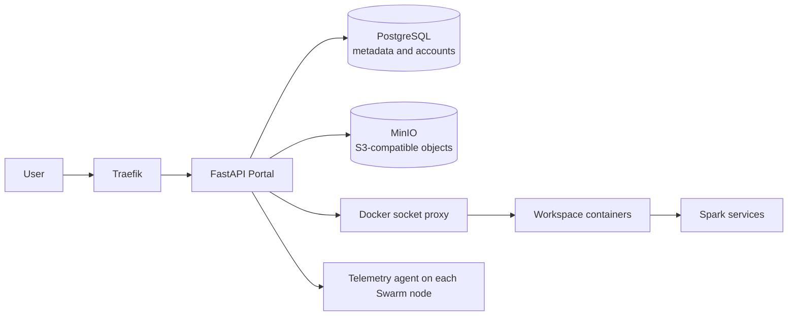

# ArenaLake

**ArenaLake is an experimental data-lake platform that brings together a web portal, S3-compatible object storage, Spark workloads, containerized workspaces, and Docker Swarm telemetry.**

[](https://github.com/L1K3D/arenalake-infra/actions/workflows/ci.yml)
[](https://github.com/L1K3D/arenalake-infra/actions/workflows/ci.yml)
[](#license)

> **Project status:** experimental. ArenaLake is intended for evaluation and
> controlled deployments, not as a supported general-purpose or
> high-availability platform. Review the [security notes](docs/security.md)
> and [deployment guide](docs/deployment.md) before exposing any service.



*Illustrative screenshot of the Portal interface; it does not represent a
running production instance.*

## What ArenaLake provides

ArenaLake integrates services and operational tooling for teams experimenting
with data engineering and distributed processing:

- A FastAPI web Portal with user-facing pages and administration APIs.
- PostgreSQL for Portal metadata and account information.
- MinIO for S3-compatible object storage.
- Apache Spark services and reusable containerized workspaces.
- A host telemetry agent deployed across eligible Swarm nodes.
- Docker Swarm deployment definitions, an interactive installer, and
  maintenance helpers.

The repository packages existing technologies into one experimental
deployment; it does not introduce a new storage format, processing engine, or
distributed-computing protocol.

## Architecture

The production deployment is a Docker Swarm stack. Traefik routes incoming
HTTP traffic to the Portal. The Portal stores metadata in PostgreSQL, accesses
objects through MinIO, manages workspace containers through a restricted
Docker socket proxy, and reads host metrics from the telemetry agents.
Workspaces connect to the configured Spark services.



| Component | Purpose | Persistent data |
|---|---|---|
| Portal (`apps/portal`) | User interface, APIs, authentication, catalog, and workspace orchestration | `${DATALAKE_STORAGE_PATH}/projects_data` |
| PostgreSQL | Portal metadata and accounts | `${DATALAKE_STORAGE_PATH}/database` |
| MinIO | S3-compatible object storage | `${DATALAKE_STORAGE_PATH}/minio_data` |
| Spark master | Coordinates Spark workloads | `${DATALAKE_STORAGE_PATH}/spark_jobs` |
| Telemetry agent (`apps/telemetry-agent`) | Exposes host CPU, memory, operating-system, and disk metrics | None |
| Docker socket proxy | Mediates Portal access to the Docker API | None |
| Workspace image | Reusable IDE and runtime image for workspace containers | Per-user Docker volumes |
| Traefik | Routes incoming HTTP traffic to the Portal | None |

Persistent paths must be available to the nodes running stateful services.
Multi-node deployments need shared storage or a correctly configured storage
network. The stack defines health checks and rollback policies for selected
services, but a Swarm rollback does not revert database schema changes or
persisted data. See [Architecture](docs/architecture.md) for additional
deployment details.

### Technology choices

| Technology | Role |
|---|---|
| Python and FastAPI | Portal APIs, web service, and operational utilities |
| PostgreSQL | Relational metadata and account storage |
| MinIO | S3-compatible object storage |
| Apache Spark | Distributed data processing |
| Docker Compose and Swarm | Service configuration and production orchestration |
| Traefik | HTTP routing to the Portal |
| GitHub Actions | Continuous integration, security analysis, and releases |

## Run locally

The development Compose configuration starts the Portal, PostgreSQL, and
MinIO. It is intended for local evaluation and does **not** configure
production Swarm, Tailscale, host telemetry, or production workspace
orchestration.

### Prerequisites

- Docker Engine or Docker Desktop with Docker Compose v2.
- A running Docker daemon.
- Git.

Python 3.11 or later is additionally required to run the repository's tests
and development checks.

### Start the development services

```bash
git clone https://github.com/L1K3D/arenalake-infra.git
cd arenalake-infra
docker compose -f deploy/compose/docker-compose.dev.yml up -d --build
```

Once the services are healthy:

- Portal: <http://localhost:8000>
- API documentation: <http://localhost:8000/docs>
- MinIO API: <http://localhost:9000>
- MinIO console: <http://localhost:9001>

The development stack binds these published ports to the local loopback
interface (`127.0.0.1`), so they are not intended to be reachable from other
machines on the network.

The development Compose file contains fixed, local-only credentials and
initializes a development administrator account. Complete the first-access
setup in the Portal. **Do not expose this configuration to an untrusted
network or reuse its credentials in production.**

Check service status and follow Portal logs:

```bash
docker compose -f deploy/compose/docker-compose.dev.yml ps
docker compose -f deploy/compose/docker-compose.dev.yml logs -f portal
```

Stop the services while retaining their data:

```bash
docker compose -f deploy/compose/docker-compose.dev.yml down
```

To delete the development database and MinIO objects as well, run
`docker compose -f deploy/compose/docker-compose.dev.yml down --volumes`.
This permanently removes the local development data.

## Production deployment

Production uses the canonical Swarm stack at
[`deploy/compose/docker-compose.yml`](deploy/compose/docker-compose.yml) and
the interactive installer at [`helpers/install.py`](helpers/install.py).
The installer performs privileged host operations, prepares persistent
storage and supporting services, generates installation-specific credentials,
writes a protected `.env` file, builds images, and deploys the stack.

The repository's
[`.env.example`](config/environment/.env.example) is a documentation and CI
fixture only; **do not copy it for production installation**. The installer
creates the production environment file. Production setup is not equivalent
to running the development Compose file.

Before installing:

1. Review the [deployment guide](docs/deployment.md), including its host
   prerequisites and installer prompts.
2. Read the [configuration reference](docs/configuration.md) and
   [security notes](docs/security.md).
3. Ensure that persistent storage, required ports, backups, and access
   controls are planned.
4. Run the installer only from a reviewed source revision on a host you
   control.

The installer may configure Docker, Swarm, NFS, and Tailscale, and may change
host directories and permissions. Do not run it casually on a shared or
production host without reviewing its actions. See
[Operations](docs/operations.md) for maintenance commands and
[Upgrade and rollback](docs/upgrade-and-rollback.md) before changing an
existing deployment.

### Production service endpoints

The current deployment publishes the Portal through Traefik on host port
`8088`; the Traefik dashboard uses `8089`, MinIO uses `9000` and `9001`, and
the Spark UI and RPC endpoints use `8080` and `7077`, respectively. Confirm
the actual configuration before deployment and restrict published ports with
host and network firewalls. Do not expose administrative interfaces or
unauthenticated endpoints publicly.

## Configuration and persistent data

The installer generates the production `.env` file. The
[environment example](config/environment/README.md) explains the purpose of
the placeholder file, and the [configuration reference](docs/configuration.md)
documents required variables, defaults, and their consumers.

Production state is stored in bind-mounted paths rooted at
`DATALAKE_STORAGE_PATH`, including database files, object data, Spark jobs,
and user project data. Back up the environment file and persistent data
together, protect backups as secrets, and verify that backups can be read
before relying on them. A service rollback does not restore an earlier copy
of persistent data.

## Development and validation

Install the pinned development tools and run the Python checks from the
repository root:

```bash
python -m venv .venv
# Linux/macOS:
. .venv/bin/activate
# Windows PowerShell:
# .venv\Scripts\Activate.ps1
python -m pip install -r config/python/requirements-dev.txt
ruff check --config config/python/ruff.toml .
ruff format --config config/python/ruff.toml --check .
python -m compileall -q apps helpers tests
python -m unittest discover -s tests -v
```

The tests that inspect service build contexts and health checks require a
rendered production Compose configuration. The complete procedure, including
the CI coverage threshold and Compose validation, is documented in the
[test suite guide](tests/README.md). Do not overwrite an existing `.env` file
when following its commands.

On pull requests and pushes to `main`, CI validates Python, YAML, Compose,
Swarm configuration, and Dockerfiles; runs lint, formatting, tests, and
dependency auditing; builds the container images; and smoke-tests and scans
the built images. The security workflow scans for committed secrets and runs
CodeQL. Automated checks improve consistency but are not an independent
security audit and do not guarantee that a deployment is secure.

## Project maturity and limitations

- ArenaLake is experimental and may change without a stable compatibility
  guarantee.
- Production installation performs privileged operations and should be
  reviewed before execution.
- The telemetry agent runs with elevated privileges and reads host `/proc` and
  `/sys`; the Portal can manage containers through the Docker API proxy.
- The current deployment configuration does not, by itself, provide a
  complete public-facing TLS and identity-management setup. Configure and
  verify an appropriate authenticated edge before external exposure.
- Health checks and service rollback do not protect against every failure and
  cannot reverse changes to persistent data.
- The project has no declared license. See [License](#license) before
  considering reuse or redistribution.

## Software summary and research context

### Statement of need

Teams experimenting with distributed processing must coordinate object
storage, metadata, job execution, workspaces, and observability. ArenaLake
provides an integrated repository and an interactive workflow for deploying
these components to an operator-managed Docker Swarm. It is an experimental
engineering platform, not a substitute for a managed service, an independent
security assessment, or a highly available production architecture.

### State of the field

ArenaLake combines established technologies rather than introducing new
storage protocols or processing algorithms. Its intended contribution is an
integrated configuration and operational workflow for evaluation and
experimentation. It does not claim published scientific results or measured
research impact. Any study using the software should identify the exact source
revision and describe its deployment configuration and limitations.

### References

- FastAPI. *FastAPI documentation*. <https://fastapi.tiangolo.com/>
- Apache Spark. *Spark documentation*. <https://spark.apache.org/docs/latest/>
- Docker. *Docker Swarm mode*. <https://docs.docker.com/engine/swarm/>
- MinIO. *MinIO documentation*. <https://min.io/docs/>

This README includes sections inspired by software descriptions used by the
*Journal of Open Source Software* (JOSS); it is **not** a JOSS submission.
A formal submission requires, among other items, an approved open-source
license, verified authorship and affiliations, appropriate scholarly
references, peer review, and a dedicated manuscript. ArenaLake currently has
no declared license and should not be described as open source or JOSS-eligible.

## Documentation

The [documentation index](docs/README.md) links to every project guide and
directory README. Start with the guide that matches your role:

| If you need to... | Read |
|---|---|
| Understand services and persistent data | [Architecture](docs/architecture.md) |
| Find environment variables and defaults | [Configuration reference](docs/configuration.md) |
| Install the production Swarm stack | [Deployment guide](docs/deployment.md) |
| Operate, diagnose, or back up an installation | [Operations](docs/operations.md) and [Troubleshooting](docs/troubleshooting.md) |
| Upgrade or recover a deployment | [Upgrade and rollback](docs/upgrade-and-rollback.md) |
| Review security concerns | [Security notes](docs/security.md) |
| Publish or deploy a release | [Release and production deployment](docs/release-and-deploy.md) |
| Run or extend automated tests | [Test suite guide](tests/README.md) |
| Contribute changes | [Contribution guide](.github/CONTRIBUTING.md) and [Code of Conduct](.github/CODE_OF_CONDUCT.md) |
| Understand repository automation | [GitHub automation guide](.github/README.md) |
| Review project changes | [Changelog](docs/CHANGELOG.md) |

Additional directory guides cover [applications](apps/README.md),
[shared configuration](config/README.md), [Python tooling](config/python/README.md),
[environment examples](config/environment/README.md),
[deployment files](deploy/README.md),
[Compose and Swarm](deploy/compose/README.md),
[Traefik](deploy/traefik/README.md),
[Docker images](docker/README.md), and
[operational helpers](helpers/README.md).

## Contributing

Contributions are welcome through pull requests. Please read the
[contribution guide](.github/CONTRIBUTING.md), follow the
[Code of Conduct](.github/CODE_OF_CONDUCT.md), and review the
[security notes](docs/security.md). Keep changes focused, update relevant
documentation and tests, and report checks that could not be run. Production
deployment must never be used to validate a pull request.

Repository maintainers should configure branch protection to require CI and
security checks. The production GitHub environment and its reviewer approval
rules must also be configured in repository settings; declaring a workflow
environment alone does not enable these protections.

## License

**No license has been declared.** There is no `LICENSE` file. Publishing code
on GitHub does not, by itself, grant permission to use, modify, or redistribute
it. Contact the copyright holder before reusing the code. Selecting a license
is a decision for the copyright holder.
