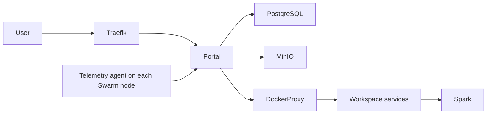

# Architecture

ArenaLake runs as a Docker Swarm stack. The root Compose file was moved to
[`deploy/compose/docker-compose.yml`](../deploy/compose/docker-compose.yml); it
defines the services and build contexts, while application code lives under
`apps/`.

| Component | Responsibility | Persistent data |
|---|---|---|
| Traefik | Routes incoming HTTP traffic to the Portal | None |
| Portal (`apps/portal`) | UI, API, authentication, workspace management, and catalog | `${DATALAKE_STORAGE_PATH}/projects_data` |
| PostgreSQL | Portal metadata and accounts | `${DATALAKE_STORAGE_PATH}/database` |
| MinIO | S3-compatible object storage | `${DATALAKE_STORAGE_PATH}/minio_data` |
| Spark master | Coordinates Spark workloads | `${DATALAKE_STORAGE_PATH}/spark_jobs` |
| Telemetry agent (`apps/telemetry-agent`) | Reports host CPU, memory, OS, and disk metrics | None |
| Docker socket proxy | Mediates Portal access to the Docker API | None |
| Workspace image | Reusable IDE/runtime image for user workspaces | Per-user Docker volumes |

`DATALAKE_STORAGE_PATH` must be available to the node running the stateful
services. Multi-node installations need shared storage or the NFS setup used by
the operational scripts.

Portal and telemetry services define container health checks and Swarm rollback
policies so failed updates can be reverted when the new tasks fail their health
checks during the configured monitoring period.

The canonical deployment is Swarm. The Compose file includes Swarm deployment
labels and global-service configuration; use the documented installer or
`docker stack deploy` flow rather than treating `docker compose up` as an
equivalent production deployment.
